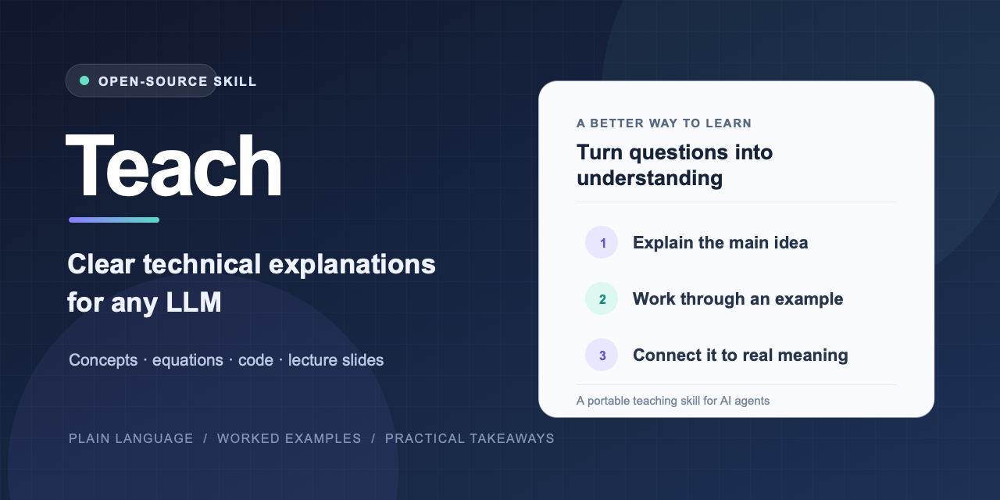

# Teach: An AI Teaching Skill for LLMs

Teach is an open-source AI teaching skill for large language models (LLMs). Add it to any LLM with custom instructions to get plain-language explanations of technical concepts, equations, code, and lecture slides, with worked examples and practical takeaways.

The portable `SKILL.md` works with AI coding agents that support Agent Skills and with any LLM that accepts custom instructions. It is designed for capable beginners and adapts the explanation to the size of the question.



**Website:** [teach-skill project page](https://grandiser.github.io/teach-skill/)

## Install

Install Teach across supported AI coding agents with the open Agent Skills CLI:

```sh
npx skills add grandiser/teach-skill --skill teach --agent '*' --global
```

This installs the skill for supported agents such as Claude Code, Codex, GitHub Copilot, Grok Build, Gemini CLI, OpenCode, Cursor, and others. See the [supported agents list](https://github.com/vercel-labs/skills#supported-agents).

### Any LLM with custom instructions

1. Open [`skills/teach/SKILL.md`](skills/teach/SKILL.md) and copy its full contents.
2. Paste the instructions into the model's custom instructions, system prompt, or saved prompt and save them.
3. Ask a normal question, such as “Explain how LLM inference works.”

This manual method works with any LLM that accepts custom instructions; it does not require a special command or runtime.

Some chat apps limit instruction length. The full `SKILL.md` is 2,656 characters, which exceeds ChatGPT Free and Go's 1,500-character custom-instructions limit. In ChatGPT, create a Project, upload `skills/teach/SKILL.md` as a project source, then add a short project instruction such as “Follow the attached Teach instructions whenever you explain a topic.” See OpenAI's guides to [Projects](https://help.openai.com/en/articles/10169521-projects-in-chatgpt) and [custom-instructions limits](https://help.openai.com/en/articles/8096356-chatgpt-custom-instructions). For other LLMs, use a project or knowledge-file feature if the custom-instructions field is too short.

## Use

Once installed, ask your LLM to teach or explain a topic. For example:

> Teach me gradient descent with a small numeric example.

You can also share a slide, image, equation, or excerpt and ask it to explain the material. The skill is intended to activate for technical teaching requests.

## Example: teaching an LLM to explain inference

These are the unedited answers returned by two separate subagents asked the same question. Teach was supplied to the second subagent:

**Without Teach — “Explain how LLM inference works”**

> LLM inference is when a trained language model generates text in response to a prompt. It breaks the prompt into tokens, processes them, and predicts which token should come next. It adds that token and repeats the prediction until it reaches a stopping point. Then it converts the tokens into readable text.

**With Teach — “Explain how LLM inference works”**

> LLM inference is how a trained language model turns a prompt into a response. It generates the response one token at a time.
>
> A **token** is a small piece of text. For example, “inference” might be one token or several. The model first splits the prompt into tokens, then processes them to estimate which token should come next.
>
> Suppose the prompt is: **“A dog says”**. The model might assign high scores to “woof” and “hello,” and lower scores to “airplane.” A decoding rule chooses one of the likely tokens. If it chooses “woof,” the model adds that token to the prompt and predicts the next one. It repeats this process until it reaches a stopping point.
>
> The model’s predictions come from patterns it learned during training. During inference, it uses those learned patterns; it does not update its training from the prompt.
>
> **In short:** inference is a repeating loop: read the text so far, choose the next token, and add it to the response.

The wording varies from run to run. These examples preserve the actual output from each run.

## Update

```sh
npx skills update teach --global
```

## Uninstall

```sh
npx skills remove teach --global
```

## Files

- `skills/teach/SKILL.md` contains the portable teaching instructions.
- `skills/teach/agents/openai.yaml` provides optional Codex display metadata.

## FAQ

### What is an AI teaching skill for large language models?

It is a reusable instruction file that guides a language model to explain a topic clearly. Teach emphasizes plain language, defined notation, worked examples, and practical meaning.

### How does Teach help an LLM explain a topic?

Teach gives the LLM a reusable teaching process: state the main idea, define unfamiliar terms or notation, work through a concrete example, and connect the result to its practical meaning. The LLM follows these instructions after the skill is installed or pasted into custom instructions; users can ask questions normally.

### How do I install Teach in ChatGPT, Claude, Gemini, Grok, or another LLM?

Use the Agent Skills CLI for supported agents, including Claude Code, Codex, GitHub Copilot, Grok Build, Gemini CLI, OpenCode, and Cursor. For ChatGPT, use a Project if the full file does not fit in custom instructions; for other LLMs, paste it into a custom-instructions, system-prompt, or saved-prompt field that accepts its length.

### Does Teach need a runtime or dependencies?

No. Teach is a Markdown instruction file. It does not need a package, API key, or runtime dependency.

### What can Teach explain?

Technical concepts, equations, notation, code, lecture slides, and other material where a clear explanation or worked example would help.

## License

This project is licensed under the MIT License. See [LICENSE](LICENSE) for details.

If Teach helps you, consider [starring the repository](https://github.com/grandiser/teach-skill).
